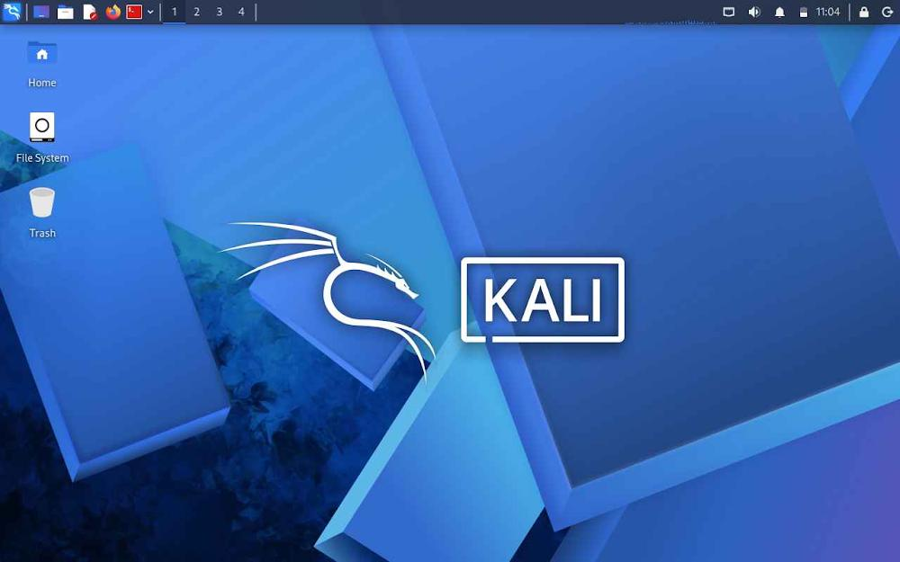
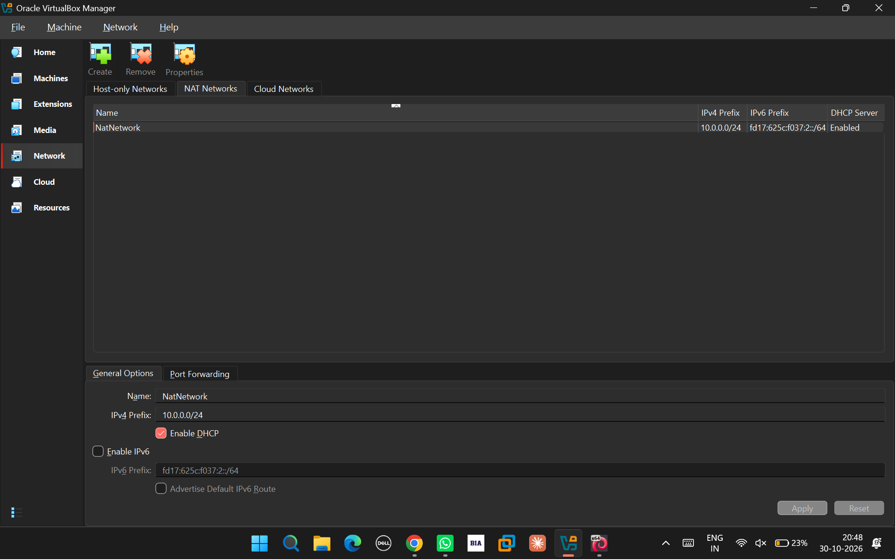
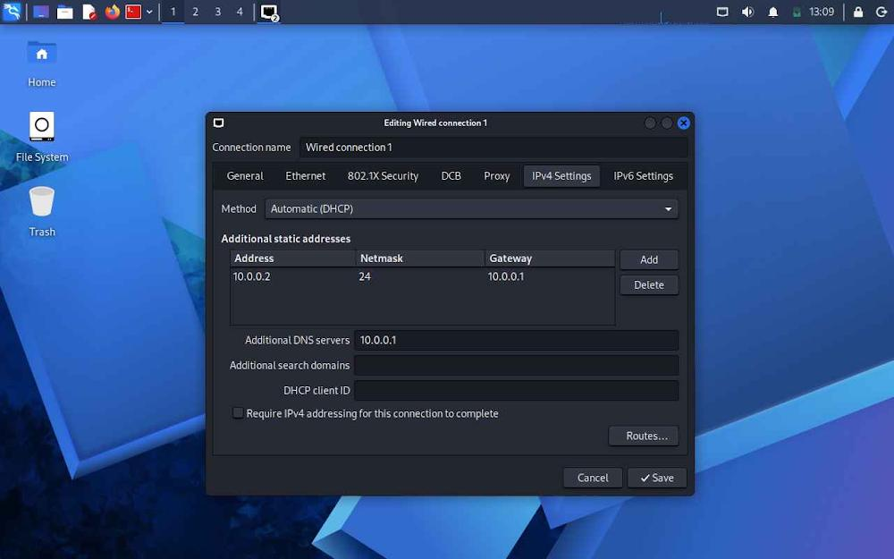

<div align="center">

# 🔐 Cybersecurity Lab Environment Setup

**Creating a Virtual Cybersecurity Practice Environment using VirtualBox and Kali Linux**

</div>

---

## 📌 1. Project Introduction

For this project, I created a virtual environment to practise different cybersecurity concepts in a safe and controlled manner. I used Oracle VirtualBox to run Kali Linux and configured a private NAT Network for the laboratory.

The main idea behind this setup is to have a dedicated environment where I can explore network security, perform reconnaissance, scan ports, analyse network traffic and practise vulnerability assessment.

This environment can also be expanded in the future by adding more virtual machines to perform authorised security testing.




## 🎯 2. Project Objectives

The primary objectives of this project are:

- Install and configure Oracle VirtualBox.
- Set up Kali Linux as a virtual machine.
- Configure a dedicated NAT Network.
- Establish network connectivity for Kali Linux.
- Configure and verify IPv4 network settings.
- Test internet connectivity and DNS resolution.
- Create a virtual machine snapshot for recovery.
- Document the complete lab configuration.

---

## 🛡️ 3. Lab Purpose

The purpose of this laboratory is to build a controlled environment for learning and practising cybersecurity techniques.

The environment can be used for:

- Network reconnaissance
- Host discovery
- Port scanning
- Vulnerability assessment
- Packet analysis
- Web application security testing
- Exploitation practice in authorised labs
- Security tool installation and testing

**Important:** All security testing will be performed only on systems that I own or have explicit permission to test.

---

## 🏗️ 4. Virtual Lab Architecture

The laboratory initially consists of a Windows host machine running VirtualBox, with Kali Linux configured as a guest virtual machine.

The Kali VM connects to a dedicated NAT Network. Additional virtual machines can be connected to this network later to create a separate testing environment.

**Network Architecture:**

```text
             Windows Host Machine
                      |
                      |
                VirtualBox
                      |
                      |
                 NAT Network
                 10.0.0.0/24
                      |
                      |
                 Kali Linux
                 10.0.0.2
                      |
                      |
             Future Target VMs
```

---


## ⚙️ 5. Lab Configuration

The following table contains the configuration details of the laboratory.

| Component | Configuration |
|---|---|
| Host Operating System | Windows 11 |
| Host RAM | 16 GB |
| Processor | Intel Core i5 |
| Virtualization Software | VirtualBox 7.2.22 |
| Guest Operating System | Kali Linux 2026.3 |
| Kali RAM | 2048 MB |
| Network Mode | NAT Network |
| Network Name | NatNetwork |
| Network Address | 10.0.0.0/24 |
| Kali IP Address | 10.0.0.2/24 |
| Default Gateway | 10.0.0.1 |
| DNS Server | 10.0.0.1 |
| Future VM Range | 10.0.0.3–10.0.0.99 |

---

# 🪜 6. Implementation Process


## Step 1: Install VirtualBox

First, I installed Oracle VirtualBox on my Windows machine.

VirtualBox provides the virtualization environment required to run Kali Linux independently without replacing the host operating system.

---

## Step 2: Configure the NAT Network

After installing VirtualBox, I created a dedicated NAT Network through the VirtualBox network settings.

The following configuration was used:

```text
Network Name: NatNetwork
IPv4 Prefix:  10.0.0.0/24
DHCP:         Enabled
IPv6:         Disabled
```

I selected NAT Network because it allows multiple virtual machines connected to the same network to communicate with each other while also supporting outbound internet connectivity.


---

## Step 3: Import and Configure Kali Linux

I downloaded the Kali Linux virtual machine from the official Kali Linux website and imported it into VirtualBox.

After importing the VM, I configured its network adapter.

**Network Adapter Settings:**

```text
Adapter:       Adapter 1
Attached To:   NAT Network
Network Name:  NatNetwork
Adapter Type:  Intel PRO/1000 MT Desktop
```

The virtual machine was allocated the following memory:

```text
RAM: 2048 MB
```

I also configured a shared folder to make file transfers between Windows and Kali Linux easier.



---

## Step 4: Configure Kali Linux Networking

After starting Kali Linux, I checked the network interface and configured the IPv4 settings.

The planned network configuration is:

```text
IP Address:    10.0.0.2
Subnet Mask:   255.255.255.0
Gateway:       10.0.0.1
DNS Server:    8.8.8.8
```

Using a consistent IP address makes it easier to identify the Kali machine during future security exercises.


---

## Step 5: Create a Virtual Machine Snapshot

Once the initial configuration was completed, I created a snapshot of the Kali Linux virtual machine.

**Snapshot Name:**

```text
Clean Kali - Network Setup
```

The snapshot provides a recovery point for the virtual machine.

If any configuration issue occurs during future experiments, I can restore the VM to its original working state instead of configuring everything again.

---

# 🔎 7. Network Testing and Verification

After completing the configuration, I performed basic connectivity checks to verify that the virtual machine was working correctly.

| Test | Command | Expected Result |
|---|---|---|
| Check IP Address | `ip a` | Displays Kali IP |
| Test Gateway | `ping 10.0.0.1` | Successful replies |
| Internet Connectivity | `ping 8.8.8.8` | Successful replies |
| DNS Resolution | `nslookup networkwalks.com` | Domain resolves |
| Nmap Verification | `nmap --version` | Displays Nmap version |
| Snapshot Testing | Restore snapshot and run `ip a` | Previous configuration restored |

### Example Network Configuration

```text
IP Address:  10.0.0.2/24
Gateway:     10.0.0.1
DNS Server:  8.8.8.8
```

These are the intended configuration values. Actual command outputs should be verified on the running virtual machine.

---

# 🐞 8. Issues Encountered and Troubleshooting

During the laboratory setup, I also explored some common issues that can occur while configuring virtual machines.

## Issue 1: Internet Connectivity Problem

After manually changing the IPv4 configuration, internet connectivity may stop working because of incorrect network settings or NetworkManager configuration.

I checked the active network connection and reviewed the IP address, gateway and DNS settings.

The following command was recorded during troubleshooting:

```bash
sudo nmcli connection modify "Wired connection 1" ipv4.dad-timeout 0
```

To identify the available network connections, I used:

```bash
nmcli connection show
```

The connection name may vary depending on the system. Network settings should always be checked before applying changes.

---

## Issue 2: VirtualBox Virtualization Error

Initially, the virtual machine could not start because hardware virtualization was disabled in the BIOS/UEFI settings.

I addressed this issue by following these steps:

1. Restarted the computer.
2. Entered the BIOS/UEFI settings.
3. Located the hardware virtualization option.
4. Enabled Intel VT-x or the available virtualization setting.
5. Saved the changes and restarted the system.
6. Started the Kali Linux virtual machine again.

After enabling hardware virtualization, the VM was able to start.

---

# 💡 9. Skills and Technical Knowledge Gained

While working on this project, I gained practical knowledge of virtual machine configuration and basic network administration.

### 1. Virtualization Technology

Understood how VirtualBox works as a hypervisor and allows multiple operating systems to run independently on a single physical computer.

### 2. NAT and NAT Network

Learned the difference between standard NAT and NAT Network configurations and how multiple virtual machines can communicate through a shared virtual network.

### 3. Network Configuration

Practised configuring network adapters and understanding how virtual network settings affect communication between machines.

### 4. IP Addressing

Gained practical experience with IPv4 addresses, subnet masks, default gateways and DNS configuration.

### 5. Virtual Machine Snapshots

Learned how snapshots help maintain a backup state of a virtual machine before performing experiments or making major changes.

### 6. Troubleshooting

Improved my understanding of common virtualization and networking issues and how to investigate them systematically.

---

# 🔐 10. Security Considerations

This laboratory has been created strictly for educational purposes and authorised cybersecurity testing.

All future experiments will be conducted within controlled environments or on systems for which proper permission has been obtained.

---

# 🔗 11. Tools and Resources

The following official resources were used during the setup:

- **Oracle VirtualBox:** https://www.virtualbox.org/wiki/Downloads
- **Kali Linux:** https://www.kali.org/get-kali/

---

# 📌 12. Project Conclusion

Through this project, I successfully worked on building the foundation of a virtual cybersecurity laboratory using VirtualBox and Kali Linux.

I configured a dedicated NAT Network, reviewed the virtual machine's network settings, performed basic connectivity checks and created a snapshot for recovery.

This setup provides a starting point for my future cybersecurity practicals, including network reconnaissance, vulnerability assessment, web application security testing and other penetration-testing exercises.

In the next stages, I plan to expand the laboratory by adding additional virtual machines and practising different security-testing techniques.

---

## 👤 13. Project Information

| Field | Details |
|---|---|
| Repository Name | week no 1 cs lab |
| Project Name | Cybersecurity Lab Environment Setup |
| Domain | Cybersecurity and Ethical Hacking |
| Platform | Oracle VirtualBox |
| Operating System | Kali Linux |
| Project Type | Practical Lab Setup |

**Prepared By:** Tanish Soni

